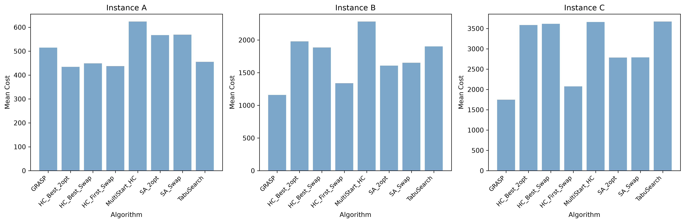
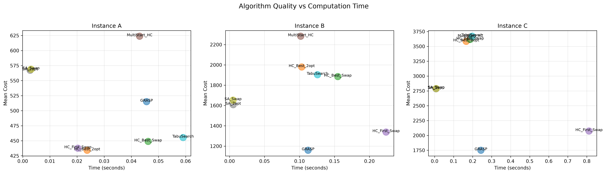
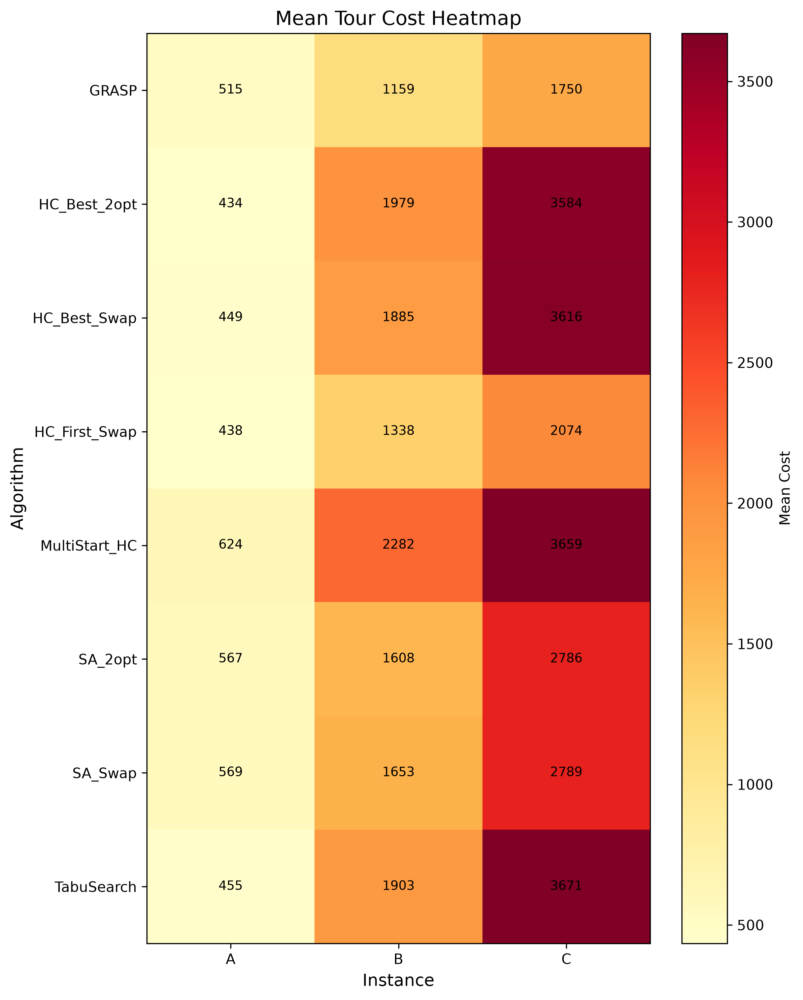

<div align="center">
  <!-- En-tête créatif -->
  

  <!-- Animation texte ciblant "Ce que fait le projet" et "Pourquoi c'est utile" -->
  

  <br/>

  <!-- Badges recommandés par GitHub -->
  <p>
    
    
    
  </p>
</div>

---

<!-- 1. CE QUE FAIT LE PROJET -->
## À propos du projet

**tsp-metaheuristics** est une suite algorithmique modulaire et un banc de test expérimental en Python conçus pour résoudre efficacement le Problème du Voyageur de Commerce (Traveling Salesman Problem - TSP). Elle permet aux chercheurs, ingénieurs et étudiants en optimisation combinatoire et recherche opérationnelle d'évaluer, de comparer statistiquement et de visualiser les performances de multiples métaheuristiques stochastiques et déterministes sur des instances de référence sans configuration complexe.

> [!NOTE]
> Pour une vue détaillée des choix de conception logicielle, du pipeline de traitement et des schémas système, consultez la [documentation d'architecture](docs/ARCHITECTURE.md).

<!-- APERÇU VISUEL -->
### Aperçu en action

<div align="center">
  
  <p><em>Comparaison des coûts moyens obtenus par chaque métaheuristique sur les instances A (20 villes), B (50 villes) et C (80 villes).</em></p>
</div>

<details>
  <summary><b>Voir plus de graphiques et visualisations d'analyse</b></summary>
  <br/>
  
  <table width="100%">
    <tr>
      <td width="50%" align="center">
        <b>Compromis Qualité vs Temps d'exécution</b><br/><br/>
        
      </td>
      <td width="50%" align="center">
        <b>Heatmap des performances par instance</b><br/><br/>
        
      </td>
    </tr>
  </table>
</details>

<!-- 2. POURQUOI LE PROJET EST UTILE -->
## Pourquoi utiliser ce projet ?

Le Problème du Voyageur de Commerce (TSP) est un problème NP-difficile fondamental dont l'espace de recherche croît factoriellement ($O(n!)$). Ce projet apporte une solution rigoureuse pour expérimenter et mesurer l'efficacité de plusieurs approches métaheuristiques :

- **Diversité des algorithmes implémentés :** Couvre un large spectre de techniques d'optimisation stochastique et de recherche locale :
  - **Hill Climbing** (variantes *Best Improvement* et *First Improvement*) avec voisinages Swap et 2-opt.
  - **Multi-Start Hill Climbing** (redémarrages aléatoires multiples pour surmonter les optima locaux).
  - **Recuit Simulé (Simulated Annealing)** avec refroidissement géométrique exponentiel et critère d'acceptation de Metropolis.
  - **Recherche Tabou (Tabu Search)** avec gestion dynamique de mémoire à court terme et critère d'aspiration.
  - **GRASP (Greedy Randomized Adaptive Search Procedure)** combinant construction gloutonne randomisée (liste restreinte de candidats RCL) et recherche locale.
- **Protocole expérimental rigoureux :** Évaluation multi-runs indépendants garantissant la significativité statistique (meilleur, pire, moyenne, écart-type, temps de calcul) sous un budget d'évaluations contrôlé.
- **Génération & persistance des données :** Gestion standardisée des instances de villes au format JSON et exportation automatique des résultats sous formats JSON brut et résumés tabulaires CSV.
- **Visualisations analytiques intégrées :** Génération automatique de heatmaps, diagrammes comparatifs et courbes de compromis qualité/temps via Matplotlib.

### Stack Technique

| Couche | Technologies |
| :--- | :--- |
| **Langage & Core** | `Python 3.10+` |
| **Calcul Numérique & Vectorisation** | `NumPy` |
| **Gestion des Données & Export** | `Pandas` (JSON / CSV) |
| **Visualisation & Graphiques** | `Matplotlib` |
| **Environnement & Outils** | CLI Python, Git, GitHub |

<!-- 3. COMMENT DÉMARRER -->
## Pour commencer

Suivez ces instructions pour cloner le projet, installer ses dépendances et exécuter les expériences localement.

### Prérequis

Assurez-vous d'avoir installé les outils suivants sur votre environnement :

- `Python` (v3.10 ou supérieur)
- `pip` (gestionnaire de paquets Python)
- `Git`

### Installation

1. **Cloner le dépôt**
   ```bash
   git clone https://github.com/essoktani-yazid/tsp-metaheuristics.git
   cd tsp-metaheuristics
   ```

2. **Créer et activer un environnement virtuel (recommandé)**
   ```bash
   python3 -m venv venv
   source venv/bin/activate  # Sur Windows : venv\Scripts\activate
   ```

3. **Installer les dépendances**
   ```bash
   pip install -r requirements.txt
   ```

4. **Initialiser les instances et valider l'installation**
   ```bash
   python init.py
   ```

### Exécution des expériences

Le projet fournit un point d'entrée CLI pour conduire les évaluations :

```bash
# 1. Exécuter un test rapide (5 runs, 5000 évaluations par instance)
python run_experiment.py --mode quick

# 2. Exécuter le benchmark complet rigoureux (30 runs, 10000 évaluations par instance)
python run_experiment.py --mode full

# 3. Lancer les exemples d'utilisation pas à pas
python examples.py

# 4. Générer les graphiques d'analyse statistique
python analyze.py
```

### Exemple d'utilisation en Python

Vous pouvez importer les modules directement dans vos propres scripts Python :

```python
from data_utils import load_standard_instances
from algorithms import SimulatedAnnealing, HillClimbing

# Charger les instances standards (A: 20 villes, B: 50 villes, C: 80 villes)
instances = load_standard_instances()
instance_a = instances['A']

# 1. Résolution par Recuit Simulé avec opérateur 2-opt
sa = SimulatedAnnealing(instance_a)
tour_sa, cost_sa = sa.solve(max_evaluations=5000, T0=100.0, alpha=0.95, neighborhood='2opt')
print(f"Meilleur coût (Recuit Simulé 2-opt) : {cost_sa:.2f}")

# 2. Résolution par Hill Climbing (First Improvement)
hc = HillClimbing(instance_a)
tour_hc, cost_hc = hc.solve(max_evaluations=5000, variant='first', neighborhood='swap')
print(f"Meilleur coût (Hill Climbing First Swap) : {cost_hc:.2f}")
```

*Pour découvrir l'ensemble des modules, classes, méthodes et paramètres CLI disponibles, consultez la [Référence API complète](docs/API.md).*

### Structure du projet

```text
.
├── data/                    # Instances de villes au format JSON (A: 20, B: 50, C: 80 villes)
├── docs/
│   ├── assets/              # Graphiques générés (comparaisons, heatmaps, scatter plots)
│   ├── API.md               # Référence complète des modules, classes et CLI
│   └── ARCHITECTURE.md      # Conception logicielle et pipeline d'exécution
├── results/                 # Sorties expérimentales (résumés CSV et données brutes JSON)
├── algorithms.py            # Classes et algorithmes métaheuristiques (HC, SA, Tabu, GRASP)
├── analyze.py               # Module de reporting statistique et génération de graphiques
├── data_utils.py            # Génération, chargement et manipulation des instances TSP
├── examples.py              # 5 exemples pratiques guidés pas-à-pas
├── experiment.py            # Moteur d'expérimentation et d'agrégation statistique
├── init.py                  # Script de vérification et d'initialisation du projet
├── run_experiment.py        # Point d'entrée CLI pour exécuter les benchmarks
├── requirements.txt         # Dépendances requises (numpy, pandas, matplotlib)
├── LICENCE                  # Licence open-source MIT
└── README.md                # Documentation principale
```

<!-- 4. AIDE & SUPPORT -->
## Aide et Support

Vous avez une question sur les métaheuristiques, l'architecture ou l'exécution du banc de test ?
- **Documentation :** Consultez les guides techniques détaillés dans le dossier [`docs/`](docs/).
- **Contact direct :** N'hésitez pas à me contacter directement via LinkedIn ou mon portfolio.

<!-- 5. CONTRIBUTION & AUTEUR -->
## Contribuer

Les contributions et propositions d'améliorations (nouveaux opérateurs de croisement, algorithmes génétiques, colonies de fourmis, etc.) sont les bienvenues !
1. **Forkez** le projet
2. Créez votre branche de fonctionnalité (`git checkout -b feature/NouvelleFonctionnalite`)
3. Commitez vos changements (`git commit -m 'feat: Ajout de NouvelleFonctionnalite'`)
4. Pushez vers la branche (`git push origin feature/NouvelleFonctionnalite`)
5. Ouvrez une **Pull Request**

## Auteur

<div align="center">

**Yazid ESSOKTANI**  
*Full-Stack Web & AI Developer*

[](https://www.essoktani.tech/)
[](https://www.linkedin.com/in/yazid-essoktani-337549251)
[](https://github.com/essoktani-yazid)

</div>

---

## Licence

Distribué sous la licence **MIT**. Consultez le fichier [`LICENCE`](LICENCE) pour plus d'informations.
