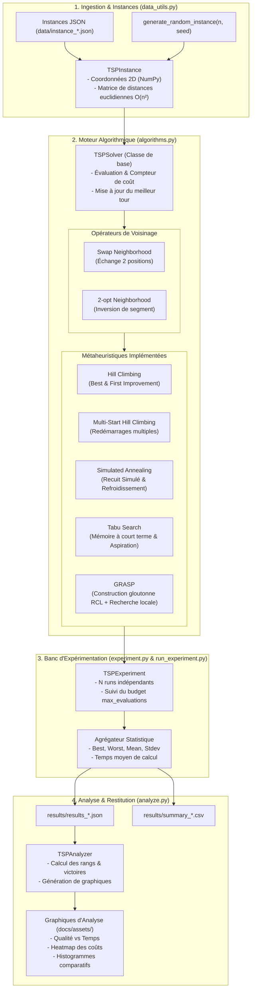

# Architecture du Système — tsp-metaheuristics

> Ce document décrit l'architecture logicielle, les choix de conception et le pipeline d'exécution expérimental de **tsp-metaheuristics**.

---

## 1. Vue d'ensemble (High-Level Design)

Le projet **tsp-metaheuristics** repose sur une architecture modulaire et orientée objet en Python, articulée autour d'un pipeline complet d'optimisation stochastique, de benchmarking statistique et de restitution visuelle.

La conception garantit :
- **L'extensibilité algorithmique :** Ajout aisé de nouvelles métaheuristiques via une classe de base unifiée (`TSPSolver`).
- **L'équité de comparaison :** Contrôle rigoureux du budget d'évaluations (`max_evaluations`) partagé entre les algorithmes.
- **La reproductibilité expérimentale :** Contrôle des graines pseudo-aléatoires (`seed`), exécution multi-runs et exportation systématique des métriques en JSON et CSV.

<div align="center">
  
  <p><em>Figure 1 : Résultats comparatifs produits par le pipeline d'expérimentation</em></p>
</div>

---

## 2. Pipeline de Données & Flux d'Exécution (Data Workflow)

Le diagramme ci-dessous illustre le flux complet de traitement des données, depuis la définition des instances jusqu'à la restitution graphique :



---

## 3. Composants Principaux

| Composant | Fichier Source | Rôle & Responsabilités |
| :--- | :--- | :--- |
| **Modèle d'Instance** | `algorithms.py` (`TSPInstance`) | Stocke les coordonnées des villes, calcule et met en cache la matrice de distances euclidiennes $N \times N$, et évalue la longueur d'une tournée en $O(N)$. |
| **Socle de Résolution** | `algorithms.py` (`TSPSolver`) | Classe abstraite définissant les primitives de génération de voisins (Swap aléatoire, 2-opt, voisinages exhaustifs) et le suivi strict du budget d'évaluations. |
| **Métaheuristiques** | `algorithms.py` (`HillClimbing`, `SimulatedAnnealing`, etc.) | Implémentations concrètes des stratégies de recherche locale, d'échappement aux optima locaux et d'exploration stochastique. |
| **Gestionnaire d'Instances** | `data_utils.py` | Génération synthétique uniforme, sérialisation/désérialisation JSON, et heuristique initiale du plus proche voisin (*Nearest Neighbor*). |
| **Cadre d'Expérimentation** | `experiment.py` (`TSPExperiment`) | Automatisation de la boucle de tests multi-instances et multi-runs, compilation des métriques statistiques et export JSON / CSV. |
| **Point d'Entrée CLI** | `run_experiment.py` | Interface en ligne de commande permettant de piloter des benchmarks rapides (`--mode quick`) ou des campagnes intensives (`--mode full`). |
| **Module d'Analyse Visuelle** | `analyze.py` (`TSPAnalyzer`) | Traitement des résultats numériques, classement des algorithmes, génération de heatmaps et de graphiques comparatifs via Matplotlib. |

---

## 4. Modèle de Données & Formats de Stockage

### 4.1. Représentation d'une Instance TSP

Les instances de villes sont sérialisées au format JSON dans le répertoire `data/` :

```json
{
  "name": "random_20",
  "cities": [
    [37.45, 95.07],
    [73.19, 59.86],
    [15.60, 15.59]
  ]
}
```

En mémoire, les coordonnées sont manipulées sous forme de tableau NumPy `(N, 2)` de flottants 64 bits. La matrice de distances symétrique $D \in \mathbb{R}^{N \times N}$ est précalculée :
$$D_{i,j} = \sqrt{(x_i - x_j)^2 + (y_i - y_j)^2}$$

### 4.2. Représentation d'une Solution

Une solution (ou tournée) est représentée par une permutation discrète $\pi$ des indices $\{0, 1, \dots, N-1\}$. Le coût total d'une tournée fermée est calculé par :
$$\text{Coût}(\pi) = \sum_{i=0}^{N-2} D_{\pi[i], \pi[i+1]} + D_{\pi[N-1], \pi[0]}$$

### 4.3. Stockage des Résultats Expérimentaux

Les résultats sont exportés dans le dossier `results/` sous deux formats complémentaires :
1. **Fichier JSON hiérarchique (`results_full.json` / `results_quick.json`) :**
   ```json
   {
     "SA_2opt": {
       "A": {
         "best": 494.55,
         "worst": 612.30,
         "mean": 567.18,
         "stdev": 47.60,
         "time_mean": 0.003,
         "time_stdev": 0.0005
       }
     }
   }
   ```
2. **Fichier CSV tabulaire (`summary_full.csv` / `summary_quick.csv`) :**
   ```text
   Algorithm,Instance,Best,Mean,Stdev,Time (s)
   SA_2opt,A,494.55,567.18,47.60,0.003
   ```

---

## 5. Choix de Conception & Analyse Algorithmique

### 5.1. Étalon d'Évaluation Partagé

Plutôt que d'interrompre les algorithmes selon une durée d'horloge (sensible à la charge machine et aux spécificités matérielles), chaque algorithme opère sous une limite stricte du nombre d'évaluations de tournées (`max_evaluations`). Cela garantit une comparaison rigoureuse, indépendante de la plateforme d'exécution.

### 5.2. Opérateurs de Voisinage : Swap vs 2-opt

- **Swap (Échange de 2 sommets) :** Modifie 4 arêtes. L'espace de voisinage comporte $\frac{N(N-1)}{2}$ voisins.
- **2-opt (Inversion de sous-tour) :** Déconnecte 2 arêtes non consécutives et reconnecte le sous-tour inversé. Idéal pour éliminer les intersections géométriques dans les espaces euclidiens 2D.

### 5.3. Compromis Intensification vs Diversification

- **Intensification (Exploitation locale) :** Assurée par le *Hill Climbing (Best Improvement)* et la phase de recherche locale de *GRASP*.
- **Diversification (Exploration globale) :** Assurée par la baisse progressive de température de *Simulated Annealing* (qui autorise des dégradations de coût selon la probabilité $e^{-\Delta / T}$), la liste taboue de *Tabu Search* qui empêche le retour en arrière, et les multiples points de départ aléatoires de *Multi-Start HC*.

---

## 6. Performance, Sécurité & Reproductibilité

- **Sécurité :** L'application s'exécute entièrement hors ligne en local, sans dépendance externe, sans appel réseau et sans manipulation de données sensibles.
- **Performance :** L'usage de tableaux contigus NumPy et le précalcul de la matrice de distances réduisent le coût d'évaluation d'une tournée à un parcours séquentiel en $O(N)$ en mémoire cache.
- **Reproductibilité :** L'injection optionnelle de graines pseudo-aléatoires (`seed`) dans `generate_random_instance()` permet de rejouer exactement les mêmes instances et parcours.

---
[⬅ Retour au README principal](../README.md)
